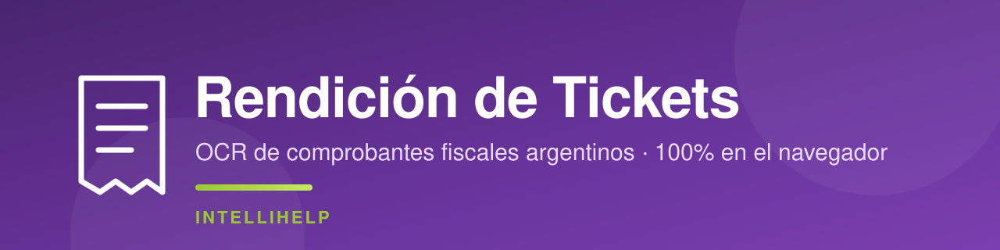
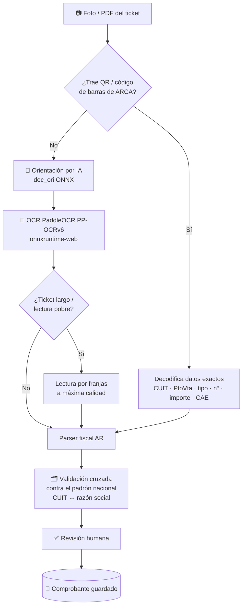

<p align="center">
  
</p>

<p align="center">
  <b>Catálogo de comprobantes fiscales argentinos con OCR 100&#37; en el navegador.</b><br>
  Sacás una foto del ticket → lee los datos (QR de ARCA + IA) → los revisás → quedan volcados como tu Excel de rendición.
</p>

<p align="center">
  <a href="https://github.com/bsierra4262/rendicion-tickets/actions/workflows/ci.yml"></a>
  
  
  
  
  
  
</p>

---

## Índice

- [Descripción](#descripción)
- [Características](#características)
- [Capturas](#capturas)
- [Cómo funciona (pipeline)](#cómo-funciona-pipeline)
- [Stack técnico](#stack-técnico)
- [Estructura del proyecto](#estructura-del-proyecto)
- [Puesta en marcha](#puesta-en-marcha)
- [Tests](#tests)
- [Seguridad](#seguridad)
- [Licencia](#licencia)

## Descripción

**Rendición de Tickets** digitaliza la carga de comprobantes de gastos (facturas A/B/C, tiques, notas
de crédito/débito) de una empresa argentina. Reemplaza la planilla de Excel por una web donde el
administrativo **saca una foto del ticket** y la aplicación **extrae automáticamente** fecha, tipo,
punto de venta, número, CUIT, razón social, importes (Neto + IVA + Percepción = Total) y concepto —
priorizando el **QR/código de barras de ARCA** como fuente de verdad y usando **OCR con IA** cuando no
lo hay. Todo corre **en el navegador**, sin APIs pagas ni certificados, con **revisión humana** antes
de guardar.

> **Demo (privada):** https://intellihelp.tech/tickets

## Características

- 📷 **Escaneo por foto o PDF** — lee el **QR de ARCA** (datos exactos, sin OCR) y el **código de barras** (RG 1702); si no hay, cae al OCR.
- 🧠 **OCR con IA en el navegador** — **PaddleOCR PP-OCRv6** vía `onnxruntime-web` (WASM/WebGPU). Sin servidor de OCR, sin costo.
- 🧭 **Orientación automática por IA** — clasificador `doc_ori` (ONNX) endereza la foto (0/90/180/270°) en una inferencia.
- 📜 **Tickets largos y ultra-largos** — lectura por franjas con solape; y **varias fotos se unen en un solo** comprobante.
- 🇦🇷 **Parser fiscal argentino** — CUIT con dígito verificador (módulo 11), tipo/letra, punto de venta-número, importes en formato AR, IVA 21/10,5/27, CAE.
- 🗂️ **Padrón nacional offline (~1,13 M empresas)** — resuelve **CUIT ↔ razón social** con **validación cruzada**: nunca asigna un dato dudoso (desambigua homónimos, detecta el CUIT del comprador, recupera lecturas con 1 error).
- 🏷️ **Categorización automática auto-entrenada** — el concepto de cada proveedor se ajusta solo con el uso.
- ✅ **Revisión humana** — todo queda como borrador `pendiente de revisión`; se corrige y se aprueba.
- 📊 **Reportes y export** — totales por mes, proveedor y concepto; export a PDF/CSV.
- 🔍 **Auditoría completa (CRON)** — cada acción y cada error (cliente y servidor) queda registrado.

## Capturas

> 🔗 **Demo en vivo:** https://intellihelp.tech/tickets

<details>
<summary><b>Ver capturas de pantalla</b></summary>

<br>

Para mostrarlas acá, colocá las imágenes en `docs/screenshots/` con estos nombres:

|  Escanear un ticket | Listado de comprobantes | Reportes |
| :---: | :---: | :---: |
|  |  |  |

</details>

## Cómo funciona (pipeline)



Cada capa tiene _fallback_: si el QR no está, va el OCR; si la IA de orientación no carga, se prueban
las 4 orientaciones; si el padrón no resuelve, se completa a mano. **Nunca se rompe y nunca inventa un dato.**

## Stack técnico

| Capa | Tecnología |
| --- | --- |
| Backend | PHP 8.2 (front-controller propio, sin framework) |
| Base de datos | MySQL / MariaDB (utf8mb4) |
| OCR | PaddleOCR PP-OCRv6 · `onnxruntime-web` · modelos ONNX (orientación) |
| Lectura de códigos | `jsQR` · `ZXing` · `BarcodeDetector` nativo |
| Front | JavaScript vanilla (sin build), CSS propio |
| Auth | Sesiones PHP + **Login con Google Workspace (OAuth 2.0)** |
| Hosting | Apache/PHP (Hostinger) |

## Estructura del proyecto

```
app/
├─ web/                 # document root: index.php (router), vistas, assets
│  ├─ app/              # lógica: comprobantes, proveedores, auth, google, helpers…
│  ├─ assets/           # js/ (escanear, paddleocr, viewer…), css/, models/ (ONNX)
│  └─ ...
├─ db/                  # schema.sql y scripts
└─ server-config/       # config.example.php  (config.php real NO se versiona)
test/                   # batería de tests de regresión (311)
md/                     # documentación (PROYECTO.md, REQUERIMIENTOS.md)
docs/                   # banner y capturas del README
```

## Puesta en marcha

```bash
# 1) Configuración (fuera del web root en producción)
cp app/server-config/config.example.php app/server-config/config.php
#   completá: DB (host/name/user/pass), app.secret, y Google OAuth (client_id/secret/dominio)

# 2) Base de datos
mysql -u USUARIO -p BASE < app/db/schema.sql

# 3) Servir app/web/ como document root del sitio (Apache/PHP 8.2)

# 4) Tests
php test/run_tests.php
```

## Tests

Batería de **311 tests de regresión** (validación de CUIT, parseo de importes AR/US, reglas fiscales,
lógica del padrón, versiones de assets, etc.). Regla del proyecto: **cada bug encontrado agrega un test**
para que no vuelva a aparecer.

```bash
php test/run_tests.php
```

## Seguridad

- `config.php` (password de la DB + `client_secret` de Google) **nunca se versiona** — está en `.gitignore`; el repo trae `config.example.php` con placeholders.
- El config real se despliega **fuera del web root** (no accesible por navegador).
- Login con Google restringido al dominio de la organización (`hd`).
- Nunca se suben datos reales de comprobantes al repositorio.

## Licencia

Software **propietario** de INTELLIHELP. Todos los derechos reservados. Uso interno; prohibida su
redistribución sin autorización.
