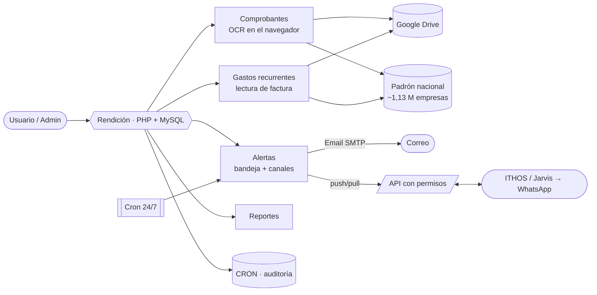
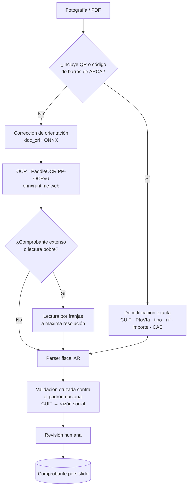
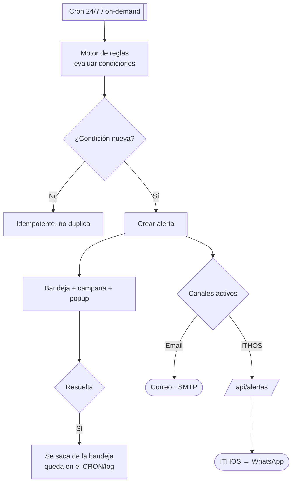

<p align="center">
  
</p>

<p align="center">
  <b>Catálogo de comprobantes fiscales argentinos con OCR ejecutado íntegramente en el navegador.</b><br>
  Digitaliza facturas y tiques a partir de una fotografía: decodifica el QR de ARCA, extrae los datos con OCR cuando no lo hay, valida contra el padrón nacional y persiste el resultado tras revisión humana.
</p>

<p align="center">
  <a href="https://github.com/bsierra4262/rendicion-tickets/actions/workflows/ci.yml"></a>
  
  
  
  
  
  
</p>

---

## Índice

- [Descripción](#descripción)
- [Características](#características)
- [Arquitectura del sistema](#arquitectura-del-sistema)
- [Pipeline de OCR (comprobantes)](#pipeline-de-ocr-comprobantes)
- [Gastos recurrentes](#gastos-recurrentes)
- [Alertas y notificaciones](#alertas-y-notificaciones)
- [API y permisos](#api-y-permisos)
- [Stack técnico](#stack-técnico)
- [Estructura del proyecto](#estructura-del-proyecto)
- [Puesta en marcha](#puesta-en-marcha)
- [Tests](#tests)
- [Seguridad](#seguridad)
- [Licencia](#licencia)
- [Autor](#autor)

## Descripción

**Rendición de Tickets** digitaliza la carga de comprobantes de gastos (facturas A/B/C,
tiques, notas de crédito y débito). Reemplaza la planilla de cálculo por una aplicación
web que, a partir de una fotografía del comprobante, extrae de forma automática la fecha,
el tipo, el punto de venta, el número, el CUIT, la razón social, los importes
(Neto + IVA + Percepción = Total) y el concepto.

El sistema prioriza el **QR / código de barras de ARCA** como fuente de verdad y recurre al
**OCR** cuando el comprobante no lo incluye. El reconocimiento se ejecuta en el navegador
del cliente, sin servicios de OCR de pago ni certificados, y todo alta queda en estado de
borrador hasta su **revisión y aprobación** por un operador.

Además del OCR de comprobantes, la plataforma incluye módulos de **gastos recurrentes**
(lectura de facturas + respaldo en Drive), **alertas** centralizadas (bandeja + Email +
ITHOS/WhatsApp, 24/7) y una **API con permisos** para integrarse con otros sistemas.

> Demo (privada): `https://intellihelp.tech/comprobantes`

## Características

- **Ingesta por fotografía o PDF.** Decodifica el QR de ARCA (datos exactos, sin OCR) y el código de barras (RG 1702); si no están, aplica OCR.
- **OCR en el navegador.** PaddleOCR PP-OCRv6 sobre `onnxruntime-web` (WASM/WebGPU). Sin servidor de reconocimiento ni costo por uso.
- **Corrección de orientación por modelo.** Un clasificador ONNX (`doc_ori`) endereza la imagen (0/90/180/270°) en una inferencia.
- **Comprobantes extensos.** Lectura por franjas con solapamiento; múltiples fotografías se combinan en un único comprobante.
- **Parser fiscal argentino.** CUIT con dígito verificador (módulo 11), tipo y letra, punto de venta y número, importes en formato local, tasas de IVA (21 / 10,5 / 27) y CAE.
- **Padrón nacional offline (~1,13 M de empresas).** Resolución cruzada CUIT ↔ razón social: no asigna datos ambiguos (desambigua homónimos, descarta el CUIT del comprador, recupera lecturas con un error).
- **Categorización auto-entrenada.** El concepto de cada proveedor se ajusta con el uso.
- **Gastos recurrentes.** Módulo aparte para servicios y gastos fijos (electricidad, expensas, alquiler, seguros, telefonía, impuestos): maestro de proveedores + lectura automática de la factura (QR de ARCA / texto / OCR) y respaldo en Drive por proveedor, año y mes. Ver [Gastos recurrentes](#gastos-recurrentes).
- **Alertas centralizadas.** Un módulo de alertas (bandeja dentro del sistema + campana con contador + popup) que avisa, por ejemplo, cuando un pago de gasto quedó vencido. El administrador configura por tipo si además se envían por Email (SMTP propio) o ITHOS (que puede reenviar por WhatsApp). Evaluación **24/7** por cron. Ver [Alertas](#alertas-y-notificaciones).
- **API con permisos.** Tokens de **lectura** (consultas, ideal para ITHOS/Jarvis) o **root** (acceso total) para integrar la app con otros sistemas. Ver [API y permisos](#api-y-permisos).
- **Respaldo en Google Drive.** Cada imagen se replica en Drive con estructura por año y mes; la copia local se conserva como respaldo.
- **Control de sesión.** Cierre automático por inactividad y por tiempo máximo, con validación del lado del servidor.
- **Auditoría completa.** Cada acción y cada error (cliente y servidor) queda registrado.

## Arquitectura del sistema

La aplicación es un front-controller PHP con módulos independientes que comparten padrón,
Drive, auditoría (CRON) y la API. Vista general:



## Pipeline de OCR (comprobantes)



Cada capa incorpora un mecanismo de degradación controlada: si el QR no está presente, se
aplica OCR; si el modelo de orientación no carga, se evalúan las cuatro rotaciones; si el
padrón no resuelve, el dato se completa manualmente. El sistema no interrumpe el flujo ni
infiere datos que no puede verificar.

## Gastos recurrentes

Módulo independiente del flujo de comprobantes para gestionar los **gastos fijos** de la
organización (electricidad, expensas, alquiler, estudio contable, telefonía, medicina
prepaga, seguros, impuestos, suscripciones). Reemplaza la planilla y las carpetas manuales.

- **Maestro de proveedores.** Cada proveedor con su rubro, categoría (recurrente / única
  vez), momento de facturación (mes adelantado / vencido), tipo de factura, vigencia de
  descuento, carpeta de Drive y **uno o varios CUIT** (rubros como expensas o bancos
  agrupan varias empresas: el match por CUIT del emisor acepta cualquiera de ellos).
- **Lectura automática de la factura** (botón «Leer factura»), en cascada de mayor a menor
  confiabilidad:
  1. **QR de ARCA** (`?p=` base64 JSON) → datos exactos: CUIT del emisor, importe, fecha.
  2. **Texto del PDF** (pdf.js) + parser: proveedor por CUIT/razón, importe = *total a
     pagar*, fecha de emisión, primer vencimiento y período. Soporta formato de número
     **AR** (`1.234,56`) y **US** (`1,234.56`) y facturas en inglés (OpenAI/ChatGPT).
  3. **OCR de imagen** (PaddleOCR) sólo si la factura es un escaneo/foto sin texto ni QR.
- **Confirmación antes de guardar.** Un popup muestra lo leído; el operador revisa y
  corrige antes de persistir (nunca se guarda a ciegas).
- **Respaldo en Drive.** Factura y comprobante de pago se suben a `Proveedor / Año / Mes`.
- **Auditoría completa.** Alta, edición, lectura y subida a Drive quedan registradas.

## Alertas y notificaciones

Módulo centralizado: cada condición de la app "empuja" una alerta idempotente que vive
**dentro del sistema** (bandeja + campana + popup) y, según la configuración del admin, se
envía además por **Email** (SMTP propio, varios destinatarios) o **ITHOS** (que la reenvía al
grupo de **WhatsApp**). Corre **24/7** por cron.



- **Reglas v1:** pago de gasto **vencido** (días de atraso), **por vencer** (≤7 días) y
  **comprobantes sin revisar**. El catálogo de tipos es extensible.
- **Modo TEST:** mientras la app esté en *testing*, los envíos externos llevan el prefijo
  `[TEST]`; al pasar a producción se quita (setting `app_entorno`).
- **Sin perder avisos:** al activar un canal que estaba apagado, se **reenvían las últimas 5**.
- **24/7:** agendá `app/cron-alertas.php` en el cron de Hostinger (hPanel) cada 5 min, o usá
  el cron-URL con clave. También evalúa on-demand y con el botón «Evaluar ahora».

## API y permisos

API para que servicios externos (ej. **ITHOS/Jarvis**) consulten datos en tiempo real, con
**permisos por token**:

- **Lectura** — solo consultar (`api/estado`, `api/comprobantes`, `api/pendientes`,
  `api/alertas`). Ideal para ITHOS. No expone acciones de administración.
- **Root** — acceso total, para integrar la app en un sistema propio.

Autenticación por header `X-API-Key` (o `Authorization: Bearer`). Se crean y revocan desde la
sección **API**. Un token **«ITHOS»** (lectura) viene generado por defecto. Guía de integración
completa: [`md/API-ALERTAS-ITHOS.md`](md/API-ALERTAS-ITHOS.md).

## Stack técnico

| Capa | Tecnología |
| --- | --- |
| Backend | PHP 8.1+ (front-controller propio, sin framework) |
| Base de datos | MySQL 8 / MariaDB 10.4+ (utf8mb4) |
| OCR | PaddleOCR PP-OCRv6 · `onnxruntime-web` · modelos ONNX (orientación) |
| Códigos | `jsQR` · `ZXing` · `BarcodeDetector` nativo |
| Front-end | JavaScript sin build, CSS con variables de tema |
| Autenticación | Sesiones PHP + OAuth 2.0 (Google Workspace) · API por token con scopes |
| Notificaciones | SMTP propio (sin dependencias) · cron (Hostinger) · integración ITHOS/WhatsApp |
| Empaquetado | Docker (PHP-Apache + MariaDB) o Apache/PHP sobre hosting |

## Estructura del proyecto

```
app/
├─ web/                 # document root: index.php (router), vistas, assets
│  ├─ app/              # dominio: comprobantes, gastos, alertas, mail, apiauth,
│  │  │                 #   auth, google, drive, actividad, helpers
│  │  ├─ pages/         # controladores por ruta (incl. api/ y cron-alertas.php)
│  │  └─ views/         # plantillas (layout, comprobantes, gastos, alertas, cron…)
│  ├─ assets/           # js (escaneo/OCR, gastos, visor), css, models (ONNX)
│  └─ .htaccess         # front controller + aislamiento
├─ db/                  # schema.sql
└─ server-config/       # config.example.php (config.php real no se versiona)
bin/                    # setup.php (instalación / diagnóstico)
docker/                 # Dockerfile assets: vhost, entrypoint, dbinit
test/                   # batería de regresión (507 casos)
md/                     # PROYECTO, REQUERIMIENTOS, API-ALERTAS-ITHOS
docs/                   # banner y capturas
```

## Puesta en marcha

### Docker

```bash
cp .env.example .env      # completar credenciales, dominio de Google y marca
docker compose up -d --build
# Aplicación en http://localhost:8080
```

El contenedor espera la base, importa `app/db/schema.sql` en el primer arranque y sirve la
aplicación. Detalle completo, incluido el despliegue en hosting web, en
[INSTALL.md](INSTALL.md).

### Hosting web

DocumentRoot en `app/web/`, importar `app/db/schema.sql`, crear `config.php` fuera del web
root (plantilla en `app/server-config/config.example.php`) y validar con:

```bash
php bin/setup.php
```

La personalización de nombre, colores y logo para otra organización se describe en
[BRANDING.md](BRANDING.md).

## Tests

Batería de regresión (validación de CUIT, parseo de importes AR/US, reglas fiscales, lógica
del padrón, control de sesión, respaldo en Drive, versionado de assets). Regla del proyecto:
**cada defecto detectado incorpora un test** para impedir su reaparición.

```bash
php test/run_tests.php
```

## Seguridad

- Los secretos (credenciales de base y `client_secret` de Google) viven en `config.php` o en
  variables de entorno; nunca se versionan. El repositorio incluye únicamente
  `config.example.php` y `.env.example` con marcadores.
- En producción, `config.php` y el almacenamiento de imágenes se ubican fuera del web root.
- El acceso se restringe al dominio de la organización (`hd`) vía Google Workspace.
- Los comprobantes se persisten como borrador y requieren aprobación humana.
- Política de reporte de vulnerabilidades en [SECURITY.md](SECURITY.md).

## Licencia

Software **propietario**, desarrollado **íntegramente por Brian Sierra**. Todos los derechos
reservados. Uso interno de la organización; se prohíbe su redistribución o uso fuera de ese
marco sin autorización expresa y por escrito del autor. El autor conserva su derecho moral de
reconocimiento de autoría (Ley 11.723 art. 52; Convenio de Berna art. 6 bis). Ver
[LICENSE](LICENSE).

## Autor

**Brian Sierra** — diseño, desarrollo e implementación completos: backend, OCR en el
navegador, parser fiscal argentino, padrón nacional, front-end, empaquetado y despliegue.
